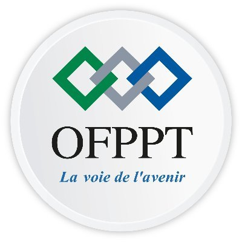

<!-- _class: cover -->

  
  

# Comprendre Agile et Scrum

### Projet : Billetterie d'événements

- **Apprenant** : Oussama Ech-charef
- **Encadrant** : ES-SARRAJ Fouad

---

# Pourquoi abandonner le Cycle en V ?

- Étapes fixes et successives.
- Le client voit le résultat à la fin.
- Les changements sont difficiles et coûteux.
- Risque de **l'effet tunnel**.

**Agile :** travailler par petits cycles et recevoir du feedback.

---

# Les 4 Valeurs du Manifeste Agile

1. **Individus et interactions** : communiquer en équipe.
2. **Logiciel fonctionnel** : montrer un produit qui marche.
3. **Collaboration client** : travailler avec le client.
4. **Adaptation au changement** : accepter les changements.

---

# Les 3 Rôles Scrum

### Product Owner (PO)
Définit les besoins et les priorités de la Billetterie.

### Scrum Master (SM)
Facilite le travail et aide l'équipe.

### Developers
Développent et testent les fonctionnalités de la plateforme.

---

# Les 5 Événements Fondamentaux

1. **Sprint** : période de travail.
2. **Sprint Planning** : planifier le Sprint.
3. **Daily Scrum** : réunion quotidienne de 15 minutes.
4. **Sprint Review** : présenter le résultat.
5. **Sprint Retrospective** : améliorer le travail.

---

# Cadrage du Sprint 1 (MVP)

### Objectif
Créer une première version de la Billetterie.

### Fonctionnalités
- Ajouter un événement.
- Afficher la liste des événements.
- Voir les informations d'un événement.

### Résultat attendu
Une première version fonctionnelle de la plateforme.

---

# Definition of Done (DoD)

Une fonctionnalité est terminée lorsque :

- Le formulaire est validé.
- L'événement est enregistré dans MySQL.
- Les événements sont affichés correctement.
- L'interface est responsive.
- Les tests manuels sont validés.
- Le code fonctionne sans erreur.

---

# Conclusion

- Cycle en V : étapes fixes.
- Agile : développement progressif.
- Scrum : organisation du travail.
- Sprint : livrer une partie fonctionnelle.

**Objectif :** créer une Billetterie d'événements utile et évolutive.

### Merci pour votre attention !