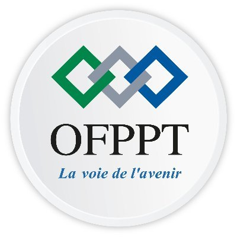

<!-- _class: cover -->

  
  

# Vision Produit et User Stories

## Projet Technique : Billetterie d'événements

- **Apprenant :** Oussama Ech-charef
- **Encadrant :** ES-SARRAJ Fouad

---

# 1. Introduction

## Pourquoi définir les besoins ?

Avant de commencer le développement, il faut comprendre les besoins des utilisateurs.

Dans une démarche Agile, nous utilisons plusieurs outils pour préparer notre projet :

- **Vision Produit :** définir l'objectif du projet.
- **Personas :** identifier les utilisateurs.
- **User Stories :** décrire leurs besoins.
- **Critères d'acceptation :** vérifier les fonctionnalités.
- **MVP :** choisir les fonctionnalités essentielles.

**Objectif :** développer une application qui répond aux besoins des utilisateurs.

---

# 2. Vision Produit

## Définition

La Vision Produit décrit l'objectif principal d'une application et la valeur qu'elle apporte aux utilisateurs.

## Notre vision – Billetterie d'événements

Créer une plateforme web qui permet :

- Aux organisateurs de publier et gérer leurs événements.
- Aux visiteurs de découvrir les événements et consulter leurs informations.

## Valeur apportée

- **Organisateurs :** faciliter la gestion des événements.
- **Visiteurs :** faciliter la découverte des événements.

---

# 3. Personas cibles

## Qui sont nos utilisateurs ?

Un Persona est un profil fictif qui représente un utilisateur cible.

### Persona 1 – Yassine

**Organisateur**

- Âge : 29 ans
- Objectif : publier et gérer ses événements.
- Besoins : ajouter, modifier et supprimer des événements.
- Contrainte : il cherche une plateforme simple et rapide.

### Persona 2 – Salma

**Visiteur**

- Âge : 22 ans
- Objectif : découvrir les événements disponibles.
- Besoins : consulter les événements et leurs détails.
- Contrainte : elle souhaite accéder rapidement aux informations depuis son téléphone.

---

# 4. User Stories – Organisateur

## US-01 : Ajouter un événement

**En tant qu'organisateur, je veux ajouter un événement afin de le présenter aux visiteurs.**

**Critères d'acceptation :**

- Le formulaire contient le titre, la description, la date, l'heure, le lieu, le prix, le nombre de places et la catégorie.
- Les champs obligatoires doivent être remplis.
- Le prix doit être positif ou égal à zéro.
- L'événement est enregistré dans la base de données avec son organisateur.

## US-02 : Gérer ses événements

**En tant qu'organisateur, je veux consulter, modifier et supprimer mes événements afin de garder mes informations à jour.**

**Critères d'acceptation :**

- L'organisateur peut consulter la liste de ses événements.
- Il peut modifier les informations d'un événement.
- Les modifications sont enregistrées.
- Le système demande une confirmation avant la suppression.

---

# 5. User Stories – Visiteur

## US-03 : Afficher les événements

**En tant que visiteur, je veux afficher la liste des événements publiés afin de découvrir les événements disponibles.**

**Critères d'acceptation :**

- La plateforme affiche uniquement les événements avec le statut « publish ».
- Chaque événement affiche son titre, sa date, son lieu et son prix.
- Un message s'affiche si aucun événement n'est disponible.

## US-04 : Consulter les détails

**En tant que visiteur, je veux consulter les détails d'un événement afin d'obtenir toutes les informations avant de participer.**

**Critères d'acceptation :**

- Le visiteur peut sélectionner un événement depuis la liste.
- La page affiche le titre, la description, la date, l'heure, le lieu et le prix.
- Les informations correspondent à l'événement sélectionné.

---

# 6. Critères d'acceptation

## Comment valider une User Story ?

Les critères d'acceptation sont des conditions qui permettent de vérifier si une fonctionnalité fonctionne correctement.

Ils doivent être :

- **Clairs :** faciles à comprendre.
- **Précis :** sans ambiguïté.
- **Mesurables :** avec des résultats identifiables.
- **Testables :** vérifiables avec des tests.

## Exemple – Ajouter un événement

| Test | Résultat attendu |
|---|---|
| Formulaire valide | L'événement est enregistré. |
| Titre manquant | Un message d'erreur s'affiche. |
| Prix négatif | Le système refuse le formulaire. |

**Résultat :** nous pouvons vérifier si la User Story respecte les besoins définis.

---

# 7. MVP – Minimum Viable Product

## Première version de notre application

Le MVP est une première version qui contient uniquement les fonctionnalités essentielles.

### Fonctionnalités incluses dans le MVP

- Ajouter un événement.
- Consulter ses événements.
- Modifier un événement.
- Supprimer un événement.
- Afficher les événements publiés.
- Consulter les détails d'un événement.

### Fonctionnalités futures

- Inscription et connexion.
- Réservation des billets.
- Paiement en ligne.
- Génération des QR Codes.
- Notifications.

**Remarque :** dans le MVP, un organisateur prédéfini utilise l'espace de gestion.

---

# 8. Périmètre du produit

## MVP et évolutions futures

| MVP – Version 1 | Versions futures |
|---|---|
| Gestion des événements | Inscription et connexion |
| Affichage des événements | Recherche avancée |
| Consultation des détails | Réservation des billets |
| Gestion des informations | Paiement en ligne |
| Catégories des événements | QR Codes et notifications |

**Notre priorité :** développer les fonctionnalités essentielles avant d'ajouter des fonctionnalités avancées.

---

# 9. Conclusion

Cette démarche nous permet de mieux préparer notre projet.

- La **Vision Produit** définit notre objectif.
- Les **Personas** représentent nos utilisateurs.
- Les **User Stories** décrivent leurs besoins.
- Les **Critères d'acceptation** vérifient les fonctionnalités.
- Le **MVP** définit les priorités du développement.

**Notre objectif :** créer une plateforme simple qui répond aux besoins des organisateurs et des visiteurs.

---

<!-- _class: end -->

# Merci pour votre attention !

## Questions ?